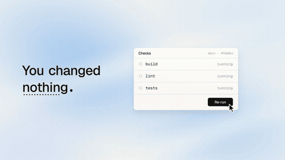
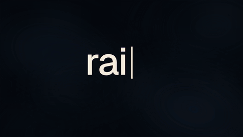

<p align="center"></p>

# Video Decompiler

**A skill that lets a coding agent make a short product film as code.** It takes a good film of the kind apart, writes your film on one page before any code, builds it with picture and sound on one clock, has it read blind, and only then shows it to you.

An agent cannot watch a frame or hear a mix, and it grades its own work kindly. The skill closes that loop with tools that report what was drawn and what the finished file holds, one clock that picture and sound both read, and blind readers before a person is asked to look: [what it adds to an agent](#what-it-adds-to-an-agent).

| | |
|---|---|
| [](docs/media/plusone.mp4) | [](docs/media/stet.mp4) |
| [](docs/media/onoma.mp4) | [](docs/media/linden.mp4) |

Click a film to watch it with its sound: a 720p copy of the cut that was accepted (Plus One's sixth, Stet's tenth, Onoma's fourth, Linden's fifth). The films themselves are 1920 by 1080 at 60 frames a second. [The record behind this page](docs/EVIDENCE.md) says who made what, what was tested, and what nobody has checked.

Four films for four made-up products. Every frame is drawn and every sound is placed by code, rendered on a laptop with [raea](https://raea.io), a GPU render engine; two of the films are built on museum pictures, and one plays recorded instruments. Each was accepted by the person it was made for. All four were made on one day, 12 November 2026, with tools and a kit built in the weeks before. All four ship whole in [`library/films`](skills/video-decompiler/library/films): source, kit, sound script and the one-page board each was built from. A new film starts as a copy of the one nearest its kind.

## What it adds to an agent

Five things here stand in for what an agent lacks:

- **Eyes, in one order.** `vd look` after every change: many moments as one picture in seconds, with a report read from the engine's own record of what it drew. `vd sound` when the sound changes. A scan inside every `vd export`, for one-frame pops, dead holds and level. `vd measure` against the film yours is held against. Then readers, and a person last, once. Text off the frame, a layer that never drew and a mix out of step with its events are caught before anyone is asked to watch. ([`EYES.md`](skills/video-decompiler/EYES.md))
- **Blind readers.** Three new agents read the film frame by frame: two, from different models, in a line-up beside an accepted film; one hunting faults. Their briefs are given word for word, so the maker does not judge its own film. ([two readings in full](docs/READINGS.md))
- **One clock.** Every event is a named beat in one table in the film's sound script, which writes both the sound and the table the picture imports. Move one number and both move. ([Plus One's `sound.py`](skills/video-decompiler/library/films/plusone/sound.py))
- **A board, and rules for it.** The whole film on one page before any code. Every change of scene is one of five kinds, and "nothing" is not one: becomes, carried, matched, door, change of ground. ([`BOARD.md`](skills/video-decompiler/BOARD.md), [`WORLD.md`](skills/video-decompiler/WORLD.md))
- **Traps, and a queue.** More than fifty known faults of the engine, each with its way out. Two of them: a mesh is built once, so resizing a shape later does nothing; past about nine frame-sized planes in perspective, the nearest vanish without a message. And one render at a time on a machine, however many agents share it. ([`TRAPS.md`](skills/video-decompiler/TRAPS.md))

Whether these make a film started cold better than the engine alone would has not been measured. [The record](docs/EVIDENCE.md) says what has.

## Two ways in, one flow

- **From a brief.** "Make a launch film for my product." The agent starts from the worked film nearest your kind (a product demo, a launch for a technical product, moving type, a brand film on real pictures) and holds yours against a good film of that kind.
- **"Make me one like this."** Hand it a film. It takes that film apart into a dossier (its world, its spine, how each scene hands to the next, where it is weak) and builds yours on its shape, with nothing of its subject.

Either way the steps are the same, and [`SKILL.md`](skills/video-decompiler/SKILL.md) gives each one a test for being done:

1. Start from a worked film, and hold yours against one good film of its kind.
2. Find the film's world and write its board: the whole film on one page ([`WORLD.md`](skills/video-decompiler/WORLD.md), [`BOARD.md`](skills/video-decompiler/BOARD.md)).
3. Gather the real material. Write the sound first; the picture reads its clock and its beats from the sound script, so a moved beat moves both (all four worked films are built this way).
4. Build the hardest shot first, then the film. Every export is scanned for one-frame pops, dead holds and level.
5. Three blind readers: two read your film in a line-up beside others, one hunts for faults frame by frame.
6. Fix the story first. Then a person watches it, once, with the sound on. Only that clears a film.

## What it is proven for, and what it is not

**Proven:** product demos, launch films for technical products, moving type, and brand films built on real still pictures. All are type, cards, interface and pictures cut to music, 29 to 38 seconds long.

**Not proven:** lit 3D scenes, scenery drawn in code, real moving footage, generated pictures, and films under ten seconds. The tools can draw them; no film of those kinds has been accepted yet, and the pages say so where it matters.

**Honest limits.** Nobody but you can hear the film: the agent checks levels, not tunes. The music is written in code (one film plays it on recorded instruments), so bringing your own finished track or a recorded voice is not yet a paved road. The four films above were made in one day by an agent with one person watching each cut and saying what was wrong. Started cold (a fresh agent, this folder and one paragraph), the skill has so far taken four test films through its own readers, each clear and plain. Both blind readers ranked every one below the worked film beside it. The person the four films were made for watched the two latest and called them close to the level of the four, with their type the place they fall short; [`BOARD.md`](skills/video-decompiler/BOARD.md) now records how the four set type. `WORLD.md` is the page written to close the gap between a clean film and one people remember; it is the newest page here and the least tested.

## What is whose

- **raea**, a separate project, draws every frame from the film's code and encodes the picture.
- **ffmpeg** decodes films for measuring, puts the sound on the picture and makes the share copy.
- **Your agent** writes the film's code and its sound script, and reads what the tools report.
- **This repository** is the rest: the method (the pages), the tools round the engine (one render at a time on a machine, the report of what did not draw, the scan of a finished film, the blind readers' packs, the measure of a film you hold yours against), the four worked films, and the tests.

## Why raea

This skill leans on three things raea does. It is fast enough to look often: on the laptop these films were made on, six moments of a film draw in about thirteen seconds, and a 38-second film at 60 frames a second exports in about two minutes. It writes a record of what it drew (each text's box, each layer's mask), and `vd look` reads faults from that record. And a composition is a function of the frame, so any frame can be drawn alone and a film can be made again: two of the four films here export frame for frame as the cuts that were accepted, and in the two built on large pictures a frame varies from one draw to the next by at most two levels of 255 (measured on Plus One; [the record](docs/EVIDENCE.md)). On the 28 moments compared, raea 0.1.2 drew the four films pixel for pixel as 0.1.1-rc4, the one they were accepted on, did. raea is young (0.1.x) and is a separate project.

## Start

**You need**

- an agent that reads skills (Claude Code, Codex, or another). The blind readers need one that can start other agents; without that, the skill tells you no reader has read the film.
- [raea](https://raea.io) 0.1.1-rc4 or newer, which runs on macOS (Apple Silicon), Linux (x86_64) and Windows (x86_64). Its own installer puts it where the skill looks: `curl -fsSL https://raea.io/install | sh` on macOS and Linux, `irm https://raea.io/install.ps1 | iex` in PowerShell on Windows. Every render says which raea it found and refuses an older one; `RAEA_BIN` points it at another. The installer gives the newest build for your system, pre-releases included. The films here were checked on 0.1.1-rc4 and 0.1.2: if the installer says it couldn't find a release (it asks GitHub without signing in, and GitHub limits that), or a first run fails on a newer raea, ask the installer for 0.1.2 (`curl -fsSL https://raea.io/install | RAEA_VERSION=0.1.2 sh`, or `$env:RAEA_VERSION = "0.1.2"` before the PowerShell line).
- ffmpeg 6 or newer and Python 3.10 or newer (the tests last passed on Python 3.12 with ffmpeg 9; `requirements-tested.txt` in the skill's folder holds the package versions).
- a graphics card: every film renders on your own machine. The four films were made on Windows 11 with an 8 GB RTX 4070. On a hosted Apple Silicon Mac the tests and the first-run check pass, all four worked films draw at sampled moments and a short starter film exports whole; nobody has yet exported a worked film or made a new one there. On Linux the tests pass without raea and nothing has been rendered.

**Install**

In Claude Code 2.1.275 or newer:

```text
/plugin install video-decompiler --marketplace JimGHTB12/video-decompiler
```

On an older Claude Code, in two steps:

```text
/plugin marketplace add JimGHTB12/video-decompiler
/plugin install video-decompiler@video-decompiler
```

To update it later, open `/plugin`, go to the Marketplaces tab, choose this one and "Update marketplace": Claude Code updates only Anthropic's own marketplaces by itself.

In Codex, copy the folder `skills/video-decompiler` into `~/.agents/skills/`. In another agent, copy it into that agent's skills folder.

Then ask your agent to set it up:

```text
Use the video-decompiler skill to set up and check my machine.
```

It makes a Python environment at `~/.venvs/video-decompiler`, outside the skill's folder so a plugin update doesn't remove it, installs `requirements.txt` into it, and runs `tools/vd.py doctor --full`. That check lists anything missing, then builds and draws a starter film and a copy of Plus One on your machine.

To do it by hand, ask your agent where the skill is installed and use that folder as `SKILL_FOLDER`. On macOS and Linux (on Ubuntu or Debian, run `sudo apt install python3-venv` first):

```text
python3 -m venv ~/.venvs/video-decompiler
~/.venvs/video-decompiler/bin/python -m pip install -r SKILL_FOLDER/requirements.txt
~/.venvs/video-decompiler/bin/python SKILL_FOLDER/tools/vd.py doctor --full
```

On Windows, in PowerShell:

```text
py -m venv "$HOME\.venvs\video-decompiler"
& "$HOME\.venvs\video-decompiler\Scripts\python.exe" -m pip install -r "SKILL_FOLDER\requirements.txt"
& "$HOME\.venvs\video-decompiler\Scripts\python.exe" "SKILL_FOLDER\tools\vd.py" doctor --full
```

## A first film

Render a film that was accepted, on your own machine, before making your own. It takes about five minutes on the laptop these films were made on (an 8 GB RTX 4070). `vd` below is the environment's Python running the skill's front door: `~/.venvs/video-decompiler/bin/python SKILL_FOLDER/tools/vd.py` on macOS and Linux, `& "$HOME\.venvs\video-decompiler\Scripts\python.exe" "SKILL_FOLDER\tools\vd.py"` in PowerShell.

```text
vd new first --like plusone      # a copy of Plus One, with its sound built
cd first
vd look --at 2,9,14,22,31,36     # six moments as one picture
vd export                        # the film and a share copy, then the scan
```

Then ask your agent for yours. In four tests, a film made cold and taken through its readers took an agent 57 to 101 minutes and 94 to 247 tool calls ([the record](docs/EVIDENCE.md)).

```text
Use the video-decompiler skill to make a launch film for PRODUCT. Here is what it does: ...
Use the video-decompiler skill to make me a film like PATH/TO/FILM.mp4, for PRODUCT.
```

## What's in the box

- [`SKILL.md`](skills/video-decompiler/SKILL.md): the steps, each with a test for being done, and what every film owes.
- [`WORLD.md`](skills/video-decompiler/WORLD.md): what separates a clean film from one people remember, and the moves that carry meaning.
- [`BOARD.md`](skills/video-decompiler/BOARD.md), [`TAKE-APART.md`](skills/video-decompiler/TAKE-APART.md): the film on one page, and how to read someone else's.
- [`EYES.md`](skills/video-decompiler/EYES.md): looking, the scan, the blind readers' briefs word for word, and the person.
- [`TECHNIQUES.md`](skills/video-decompiler/TECHNIQUES.md), [`TRAPS.md`](skills/video-decompiler/TRAPS.md): what is proven to draw, and the known engine faults with their ways out.
- `tools/vd.py`: the front door (`doctor`, `new`, `look`, `sound`, `render`, `export`, `scan`, `pack`, `measure`, `pin`, `profile`).
- `library/films/`: the worked films. The rest of `library/` is older starters and recipes, kept for the unproven kinds. Every film folder `vd new` makes carries `LICENSE-video-decompiler.txt`, the MIT notice for the code copied into it.

## What it writes on your machine

- `~/.venvs/video-decompiler`: its Python environment.
- `~/.vd/out/NAME`: everything rendered for the film folder NAME (looks, cuts, scans). Every cut is kept, so a film's folder there grows by a few hundred megabytes; it is yours to clear.
- `~/.vd/reads`: the packs given to blind readers.
- `~/.vd/measures`: what was measured of a film you gave it (`vd pin`, `vd measure`, `vd pack`), kept so a second call on the same file is quick.
- `~/.vd/usage.log`: one line for each command run (the time, the command, the folder, the seconds).

It reads what you give it and the films it makes, with one exception: `vd profile` reads the Claude Code session log of the session that made a film (under `~/.claude/projects`), to say where the time went.

Nothing is sent anywhere: no tool here uses the network.

## When something goes wrong

Run `vd doctor --full` and open an issue here with its whole output and what you asked for: it names the machine, every missing part and the first thing that failed (it prints paths on your machine too, so read it before you post it). Known engine faults and their ways out are in `TRAPS.md`.

Two limits of the render queue are known and not yet mended; a review of the code found them, and neither has been seen in use. On macOS and Linux, a heavy job (`tools/heavy.py`) whose wrapper is killed by force can go on running while the queue lets the next job start; on Windows the job ends with its wrapper. And on a disk too full to write the queue's small note, a render started by a job that holds the queue can wait on its own parent until its time runs out.

## Tests

From the repository's folder, with the environment's Python:

```text
python tests/run.py
```

It runs every test and says what passed, failed and was skipped. Each tool is tested against a fault with a known answer. On every change the same tests run on Linux, Windows and macOS, and twice more on a Mac that installs raea as its page says and sets up by the lines above, where nothing is skipped and a short film is then exported whole. One of the two uses raea 0.1.2 and must pass; the other uses whatever raea's installer gives that day, pre-releases included, and is watched: [](https://github.com/JimGHTB12/video-decompiler/actions/workflows/tests.yml)

## Rights

You're responsible for having the right to use any material you put in a film and anything you publish from it. A film you are handed to take apart lends its shape, never its pictures, words or music.

## Licence and credits

MIT for the code and the writing in this repository. The pictures, fonts and recorded instruments inside the worked films come from other people and keep their own licences, as do two fonts in the library: see [`NOTICE`](NOTICE). raea is a separate project with its own licence. Contributions are welcome: [`CONTRIBUTING.md`](CONTRIBUTING.md).
